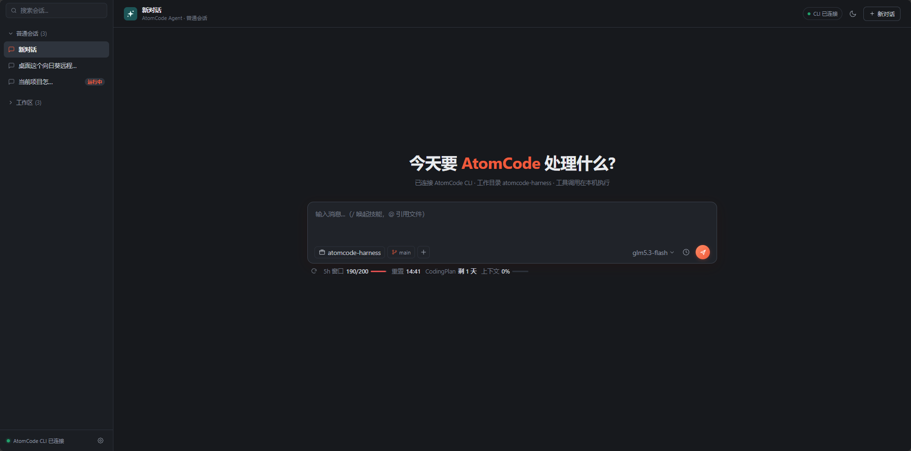

# AtomCode Harness

一个本地 Web Harness，通过 headless 流式模式驱动 [AtomCode CLI](https://atomcode.atomgit.com/?lang=zh)，在浏览器中完成与 Agent 的多会话对话。




## 关于 AtomCode

目前官方**没有提供桌面版客户端**，只有 CLI。使用本项目前需要先安装 AtomCode：

- 官网：<https://atomcode.atomgit.com/?lang=zh>

**CodingPlan 免费权益活动**：当前可免费领取 7 天 CodingPlan 权益，系统自动发放当前可获得的最高权益；调用额度按 5 小时滚动窗口计量；7 天到期后可以继续领取，没有次数限制。

- 活动地址：<https://atomgit.com/?tn=atomcode-coding-plan>

**可用模型**：`qwen3.8-27b` | `glm5.3-flash`


## 功能特性

- **多会话管理**：普通会话 / 工作区会话分组展示，工作区按所选目录分组、可折叠，会话支持重命名、删除、运行状态徽标（运行中 / 已完成 / 失败）
- **流式输出**：思考过程实时显示最新一段（固定高度、滚动锚定，内容不跳动）、工具调用过程、平滑滚动跟随
- **工作区锁定**：会话的工作区在创建时选定，不可更改；选择目录即在该目录新建会话
- **会话状态保持**：切换会话时各自的输入草稿、附件、发送按钮状态相互独立；刷新页面自动恢复上次所在会话
- **附件与截图**：粘贴截图 / 选择文件上传到工作目录，附件可点击灯箱预览
- **消息操作**：助手回复可复制；用户消息可复制、可重新编辑（内容回填输入框）
- **额度面板**：通过 AtomCode daemon 读取 CodingPlan 额度、5h 窗口、上下文占用
- **代码分支**：输入栏显示当前会话工作目录的 git 分支（非 git 目录自动隐藏）


## 环境要求

- Node.js（建议 ≥ 18；兼容 16，daemon 探测使用内置 `http` 模块）
- 本机已安装 [AtomCode](https://atomcode.atomgit.com/?lang=zh) CLI 并完成登录（`atomcode login`）


## 快速开始

```bash
npm start        # 即 node server.js，无需安装依赖
```

启动后浏览器访问 `http://localhost:3000`（以控制台输出为准）。


## 配置

通过页面右上角设置或输入栏工具配置：

| 配置项 | 说明 |
| --- | --- |
| 工作目录 | Agent 以 `-C` 参数在该目录运行，文件与命令作用于该目录 |
| 模型 | 来自 `~/.atomcode/config.toml` 的模型列表 |
| 跳过权限确认 / 禁用工具 | 会话级开关 |

环境变量：

- `ATOMCODE_DAEMON_PORT`：自定义额度 daemon 端口（默认 13458，备选 13459）
- `ATOMCODE_NO_UPDATE`：启动 CLI 时禁用自动更新（默认已开启）


## 项目结构

```
server.js          HTTP 服务：静态页面、会话存储、SSE 流式代理、daemon 额度接口
lib/cli.js         AtomCode CLI 桥接：headless 运行、模型/技能/文件列表、daemon 管理
lib/store.js       会话与消息的 JSON 文件存储（data/）
public/            前端单页（原生 JS，无构建步骤）
data/              运行时生成的会话数据（不入库）
```


## 注意事项

- 会话数据与上传的附件保存在本地 `data/` 与各工作目录的 `.atomcode-harness/uploads/`，请注意隐私
- 额度功能依赖本机 daemon；若 IDE 插件已占用端口，会自动改用备用端口启动独立 daemon
